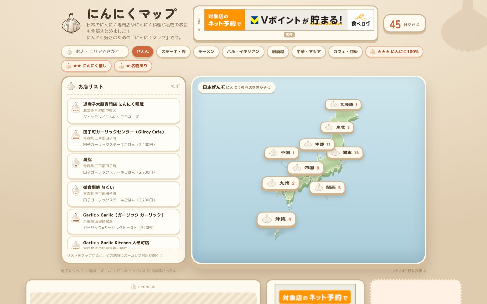
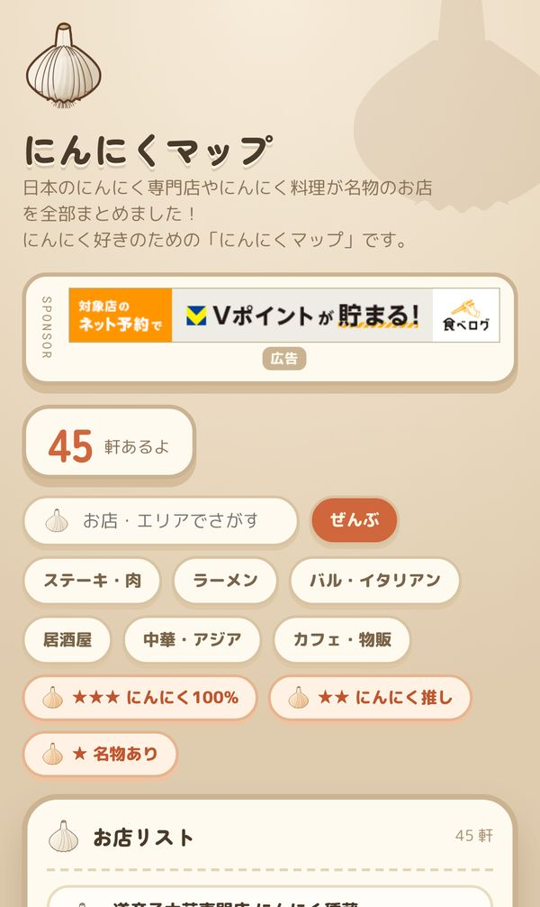

# にんにくマップ（ninnikumap.com）

全国のにんにく専門店・にんにく料理の名店を、地図から探せるサイトのソースコードです。

- 本番: https://ninnikumap.com/





## 主な機能

- 地域・ジャンル・にんにく度（3段階）での絞り込みと、日本地図の上のピン
- 店舗ごとの詳細カード（公式情報へのリンクつき）
- 食べログの予約ページへのリンク（予約できるお店のみ）

## 技術構成

- **依存のない静的サイト生成**：Node.js のスクリプトだけで `public/` を生成します（`scripts/build.mjs`）
- **地図エンジンは自作**：`public/core.js` が投影・配置・ピンの当たり判定を、`public/app.js` が小さな仮想 DOM で描画を担当します
- **座標**：国土地理院の住所検索 API で取得し、結果をキャッシュしています（`scripts/geocode.mjs`）
- **配信**：Cloudflare Pages

## 掲載とデータの方針

- 店舗データの正本は `data/shops.json` です。1軒ずつ公式情報などで確かめ、確認した URL を `sources` に残しています。
- 独自の点数やランキングは付けず、他サイトの評価点も転載しません。
- 閉店・移転が分かったお店は載せず、理由を `data/excluded.json` に残しています。
- 本文の件数は手で書かず、データから機械的に集計しています（`scripts/check.mjs` が照合します）。

## 動かし方

```bash
npm run geocode             # 住所から座標を埋める・検算する
npm run build               # public/ に静的サイトを生成
npm run check               # 出荷前の機械チェック（リンク切れ・SEO 要素・データの整合）
npm run dev                 # http://127.0.0.1:8799/
node scripts/e2e.mjs 8799   # 別のターミナルで、実ブラウザでの動作とレイアウトを確認
npm test                    # アフィリエイト層のテスト
```

## 開発について

AIを使い、企画から実装・掲載店の確認・運用まで1人で開発しています。

## クレジット

- 日本地図の形状：Natural Earth（パブリックドメイン）を簡略化したもの
- 住所の座標：国土地理院 住所検索 API

## このリポジトリについて

- 本番で動いているサイトのソースコードを、閲覧用に公開しています。
- 社内の手順書は含めていません。
- ライセンスは付けていません。著作権は作者に帰属します。
